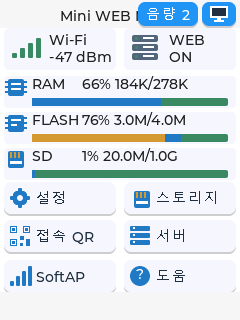
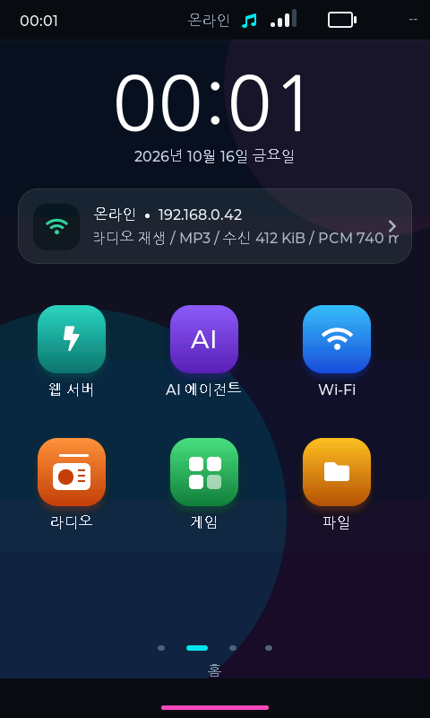

# ESP32 mini WebServer

ESP32 보드에 웹 콘텐츠를 담고, 휴대전화·PC 브라우저에서 관리하는 ESP-IDF 프로젝트입니다. LCD가 없는 C3·S3부터 터치 화면을 갖춘 M1·M3까지 같은 웹 관리 흐름을 확장합니다. M1·M3에는 LVGL 기반 온보드 인터페이스를 제공합니다.

웹페이지를 보드에서 직접 제공하고, 관리자에서 상태·파일·저장공간을 확인하며, 외부 AI 서비스를 연결해 웹 제작과 보드 진단을 요청하는 것이 목표입니다. 지원 기능은 모델과 펌웨어 구성에 따라 다릅니다.

## 구동 화면 먼저 보기

아래는 **실제 UI 소스를 LVGL PC 시뮬레이터로 렌더링한 화면**입니다. 2026년 10월 16일 캡처이며, 네트워크·저장소·재생·AI 상태는 모의 데이터입니다. 현재 소스는 이후에도 변경되어 화면 구성에 차이가 있을 수 있습니다.

| M1: 상태를 바로 확인하는 터치 대시보드 | M3: 앱으로 탐색하는 멀티미디어 UI |
| --- | --- |
|  |  |

[화면별 설명과 시뮬레이터 캡처 갤러리](docs/SCREENSHOTS.md) · [전체 문서](docs/README.md)

## 어떤 작업을 할 수 있나요?

| 작업 | 사용 흐름과 이점 |
| --- | --- |
| 나만의 웹 제공 | 소개 페이지, 매장 안내, 교육용 콘텐츠를 HTML·CSS·JS 파일로 준비해 보드에서 제공합니다. |
| 브라우저에서 보드 관리 | 메모리·연결 상태·저장소·로그를 확인해 점검을 시작합니다. 별도 PC 관리 앱 없이 브라우저로 접근합니다. |
| 콘텐츠와 저장공간 관리 | 파일 업로드·목록·다운로드·삭제, 메인 HTML 지정과 QR 안내를 사용합니다. SD 지원 모델은 SD 목록도 관리합니다. |
| AI와 작업 | 외부 AI API를 설정한 뒤 자연어로 웹 제작·수정, 파일 조회, 진단·로그 분석을 요청합니다. 사용 도구와 지원 범위는 모델별로 확인하세요. |
| 화면에서 직접 조작 | M1은 Wi-Fi·QR·저장소 중심의 터치 UI, M3는 런처·라디오·파일·갤러리·음성 기능을 앱 형태로 제공합니다. |
| 외부 미디어와 연계 | 큰 이미지·영상 등은 외부 미디어 저장소를 활용할 수 있습니다. 클라우드 중계와 R2 구성은 별도 서버 설정이 필요합니다. |

## 모델별 구성

| 모델 | 대상과 인터페이스 | 특징과 확인할 점 |
| --- | --- | --- |
| [C3](<mini-WEB (C3-ESP-IDF_ver)>) | ESP32-C3 · 브라우저 중심 | 작은 웹 콘텐츠, SoftAP 설정, 관리자와 AI 웹 인터페이스. |
| [S3](<mini-WEB (S3-ESP-IDF_ver)>) | ESP32-S3 · 브라우저 중심 | 웹·파일·AI 기능을 확장하는 일반 S3 구성. |
| [S3-N16R8-SD](<mini-WEB (S3-N16R8-SD-ESP-IDF_ver)/README.md>) | 16MB Flash · 8MB PSRAM · SDMMC | 일반 S3와 별도 펌웨어입니다. SD·클라우드 기능을 포함하며 카메라는 사용하지 않습니다. |
| [M1](<mini-WEB (M1-ESP-IDF_ver)/README.md>) | ESP32-2432S028 계열 · 2.8인치 240×320 터치 | LVGL 대시보드, 온보드 키보드, Wi-Fi 설정, QR 접속과 저장소 탐색. |
| [M3](<mini-WEB (M3-ESP-IDF_ver)/README.md>) | GUITION JC4880P443C_I_W · ESP32-P4 + C6 · 4.3인치 480×800 터치 | 16MB Flash·32MB PSRAM, LVGL 9 앱 UI, ES8311 오디오·SD·라디오·갤러리·AI/음성 기능. 호환 C6 펌웨어가 필요합니다. |
| [P4](<mini-WEB (P4-ESP-IDF_ver)/README.md>) | Waveshare ESP32-P4-Module-DEV-KIT + C6 | ESP-Hosted 무선 웹서버·SD 파일 관리. M3와 보드 배선·디스플레이 구성이 다릅니다. |

M3의 최근 기능 설명은 [라디오](<mini-WEB (M3-ESP-IDF_ver)/docs/RADIO.md>), [홈 위젯](<mini-WEB (M3-ESP-IDF_ver)/docs/HOME_WIDGETS.md>), [AI Agent](<mini-WEB (M3-ESP-IDF_ver)/docs/GEMINI_AGENT.md>), [음성 입력](<mini-WEB (M3-ESP-IDF_ver)/docs/VOICE_INPUT.md>)에서 확인할 수 있습니다. 외부 AI·STT·라디오 서비스에는 인터넷과 해당 서비스 설정이 필요합니다.

## 처음 사용하기

1. 실제 보드 모델과 PCB·화면·SD 배선에 맞는 펌웨어 폴더를 선택합니다. 모델별 README의 ESP-IDF 버전·타깃·파티션·의존성을 확인하고 빌드·업로드합니다. P4/M3는 C6 호환 펌웨어도 확인합니다.
2. 첫 설정 또는 공유기 연결 실패 시 설정용 SoftAP에 연결합니다. 기본 이름은 `Mini-WebServer-Setup`, M3는 `Mini-WebServer-M3-Setup`입니다.
3. `http://192.168.4.1/setup`에서 공유기와 DHCP/고정 IP를 설정합니다. 저장·재시작 후 휴대전화·PC를 같은 공유기에 연결합니다.
4. 보드의 IP 또는 지원되는 mDNS 주소로 웹을 엽니다. 관리자 `/admin`에서 콘텐츠와 상태를 관리합니다. 주소는 실제 네트워크에 따라 다릅니다.
5. 보드에 맞는 HTML·미디어를 올리고 메인 화면을 지정합니다. M3의 SD 구성은 [SD 앱 안내](<mini-WEB (M3-ESP-IDF_ver)/docs/SD_APPS.md>)와 모델별 README도 확인하세요.
6. AI를 사용하려면 관리자 인증과 외부 API 키를 설정하고 보드를 인터넷에 연결합니다. 키 미등록 상태에서는 실제 AI 응답을 생성할 수 없습니다.

[Wi-Fi·IP 설정](docs/WIFI_SETUP.md) · [mDNS 접속](docs/MDNS_ACCESS.md) · [파일 관리](docs/FILE_MANAGER.md) · [AI 라우팅](docs/AI_ROUTER.md) · [미디어 분석과 진단](docs/AI_MEDIA_DIAGNOSTICS.md)

## AI·미디어·외부 접속의 사용 범위

- AI는 보드 안에서 대형 언어모델을 실행하는 방식이 아니라 외부 서비스 연결 방식입니다. API 키·요금·모델 가용성과 입력 제한은 서비스 설정에 영향을 받습니다.
- 파일·미디어·진단 도구를 요청하면 해당 내용이 외부 AI에 전달될 수 있습니다. API 키와 비밀번호를 예제·웹파일·로그에 넣지 마세요. [인증과 키 보호](docs/AI_SECURITY.md)를 확인하세요.
- MP4 미디어 분석은 화면 표본을 분석하며 음성 분석과 다릅니다. 지원 파일 크기와 형식은 [미디어 문서](docs/AI_MEDIA_DIAGNOSTICS.md)를 따르세요.
- 같은 LAN 접속과 인터넷 외부 접속은 별도 구성입니다. `cloud-relay`·터널·미디어 저장소는 독립적으로 설정해야 하며, 로컬 관리자 주소를 그대로 공개하는 구성은 피하세요.

## 검증 자료 읽는 법

| 자료 | 확인할 수 있는 것 | 별도 확인이 필요한 것 |
| --- | --- | --- |
| PC 시뮬레이터 이미지 | 실제 UI 소스의 레이아웃·글꼴·화면 구성 | 보드 FPS·터치·Wi-Fi·SD·실제 오디오·AI 응답 |
| 호스트 테스트 | 대상 로직·스크립트·형식과 계약 검사 | 펌웨어 전체 빌드·부팅·실기기 통합 |
| 실기기 브라우저 캡처 | 촬영 시점의 관리자·설정 표시 | 장시간 안정성·전송 성능·모든 쓰기 작업 |

문서와 캡처에 나온 기능이 모든 보드에서 검증되었다는 의미는 아닙니다. 이 소개 문서 업데이트에서는 펌웨어를 빌드하거나 보드에 업로드하지 않았습니다.

## 폴더 안내

| 위치 | 내용 |
| --- | --- |
| `mini-WEB (...-ESP-IDF_ver)` | 보드별 펌웨어 프로젝트 |
| [docs](docs/README.md) | Wi-Fi·IP 설정, 관리자, AI, 파일 관리, 보안 문서 |
| [scripts](scripts/README.md) | Windows 웹 서버·터널 실행 파일 |
| `tools` | 공통 소스 생성, 동기화, 호스트 검사 도구 |
| `web_examples` | 보드에 업로드하는 웹 예제와 미디어 |
| `sites` | 별도 호스팅 사이트의 원본·배포 프로젝트 |
| `cloud-relay` | 클라우드 중계 서버 |
| `기획서` | 기획·보고서·신청서 등 로컬 자료 |
| `모델링` | 케이스·부품 CAD 자료와 참고 원본 |
| `releases` | 배포용 압축 파일 |
| `firmware_upload` | 보드 업로드용 펌웨어 산출물 |
| `results`, `test`, `patch_backups` | 검증 결과·테스트 자료·수정 전 백업 |

최근 P4 소개 페이지는 [web_examples/13_p4_webserver/index.html](web_examples/13_p4_webserver/index.html)에 있습니다. 폴더 정리 시 파일을 삭제하지 않았으며 이동 기록은 `results/folder_cleanup/2026-10-10-moves.json`에 보관했습니다.

## 웹 예제

PC에서 이미지를 P4용 JPG/BMP 또는 웹용 WebP로 줄이려면 `scripts/ESP32_Image_Converter.bat`을 실행하세요. 파일·폴더 일괄 변환과 크기·품질 설정을 지원합니다. [이미지 변환기 사용법](tools/ESP32_IMAGE_CONVERTER.md)을 참고하세요.

`web_examples`에 보드에서 제공할 HTML 및 미디어 예제가 있습니다. `scripts/Serve_Bianca_ngrok.bat`을 실행하면 Bianca/Fernando 보드용 웹 파일을 로컬 서버와 기존 ngrok으로 제공합니다. Python과 ngrok 설치 및 ngrok 계정 인증이 필요합니다. 세부 사용법은 `web_examples/09_bianca_fernando/README.md`를 참고하세요.

## S3 AI 키 저장 수정

키 저장 실패 시 입력값 유지, 중복 저장 방지, 저장 상태 조회 경쟁 방지 및 형식·암호화·NVS 오류 구분을 반영했습니다. `node "mini-WEB (S3-ESP-IDF_ver)/tools/test_ai_key.cjs"`로 관련 호스트 테스트를 실행할 수 있습니다. 실제 보드 검증은 별도로 필요합니다.

## AI 미디어와 진단

AI Assistant의 일반 대화와 보드 작업 분기는 [AI_ROUTER.md](docs/AI_ROUTER.md)에 설명되어 있습니다. 인사·질문에는 자연어로 답하고, 실제 작업에 필요한 도구만 활성화합니다. M1·S3·C3·S3-N16R8-SD에 적용했습니다.

S3·C3·M1에서 보드의 JPG 이미지와 MP4 화면 표본을 AI로 분석하고, 하드웨어·메모리·네트워크·최근 로그를 조회할 수 있습니다. MP4는 최대 3개 시점의 화면을 분석하며 음성은 포함하지 않습니다. 사용법과 제한은 [AI_MEDIA_DIAGNOSTICS.md](docs/AI_MEDIA_DIAGNOSTICS.md)를 참고하세요.

개인 신청서, 설계 파일, 백업 및 로컬 인증정보는 업로드 범위에서 제외합니다.

모든 펌웨어에서 SoftAP로 Wi-Fi와 서버 고정 IP를 설정할 수 있습니다. [Wi-Fi·IP 설정 사용법](docs/WIFI_SETUP.md)을 참고하세요.
