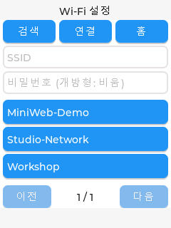
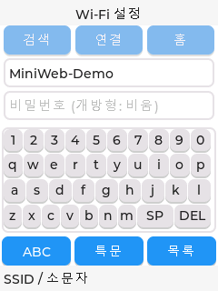
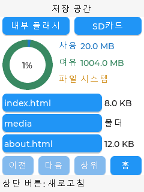
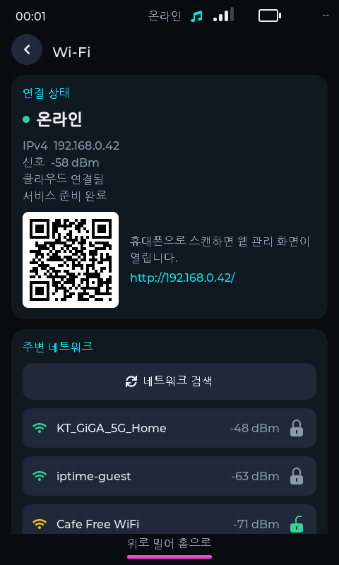
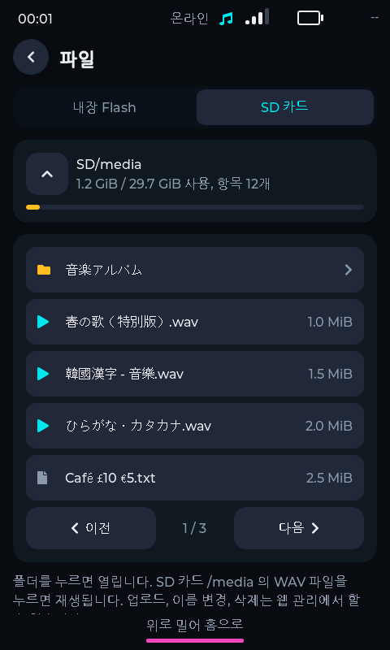
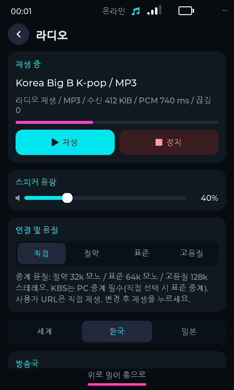
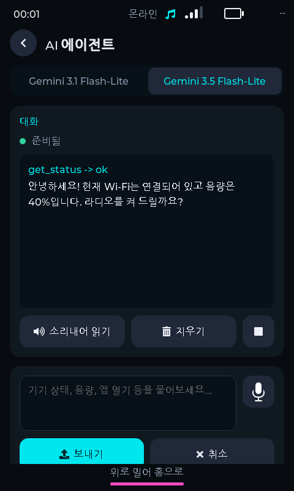
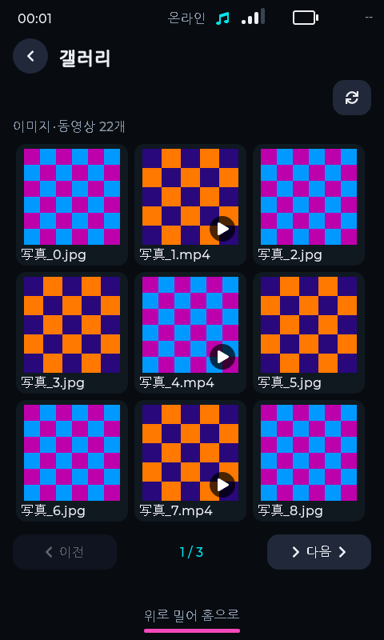

# M1·M3 구동 화면: PC 시뮬레이터

[프로젝트 홈](../README.md) · [문서 목록](README.md)

이 갤러리는 실제 펌웨어 UI 소스를 PC의 LVGL 렌더러에서 실행해 만든 PNG입니다. 웹에서 모양만 흉내 낸 목업이 아닙니다. M1은 LVGL 8.4, M3는 LVGL 9.2.2를 사용했습니다.

**캡처 시점: 2026년 10월 16일.** 이후 소스가 변경되어 최신 펌웨어의 홈 배치·앱·문구와 다를 수 있습니다. Wi-Fi·IP·파일·용량·재생·AI 등 서비스는 모의 응답이며 실기기 기능 성공의 증거가 아닙니다. AI 화면의 예시 텍스트도 실제 외부 AI 추론 결과가 아닙니다.

## M1: 상태를 보고 연결하는 작은 화면

240×320 터치 UI입니다. 연결·서버·RAM·Flash·SD 상태를 홈에서 확인하고, Wi-Fi·키보드·파일·QR 화면으로 이동합니다.

| 홈 대시보드 | Wi-Fi 선택 | 온보드 키보드 |
| --- | --- | --- |
|  |  |  |

| SD 스토리지 | 접속 QR |
| --- | --- |
|  |  |

휴대전화로 QR을 읽거나 화면에서 Wi-Fi 설정을 시작하는 흐름을 보여줍니다. QR의 예시 주소는 실제 보드 접속 주소로 사용할 수 없습니다.

## M3: 앱을 탐색하는 멀티미디어 화면

480×800 세로형 LVGL UI입니다. 아래 홈·파일·라디오·AI 화면은 캡처 당시의 UI입니다. 최근 홈 위젯·앱 변경은 [M3 README](<../mini-WEB (M3-ESP-IDF_ver)/README.md>)를 우선 확인하세요.

| 홈 런처 | Wi-Fi 설정 |
| --- | --- |
|  |  |

| 파일 탐색 | 인터넷 라디오 |
| --- | --- |
|  |  |

| AI Agent | 갤러리 |
| --- | --- |
|  |  |

라디오 캡처는 UI 상태 표시이며 실제 방송 수신·스피커 재생을 확인한 것이 아닙니다. 갤러리의 체크무늬 표본은 촬영용 모의 미디어입니다.

## 시뮬레이터의 구성과 재현

- M1·M3의 실제 UI와 LVGL을 호스트에서 렌더링하고 서비스 API를 모의 구현에 연결했습니다. 촬영 당시 사용한 공통 호스트 래퍼는 로컬 캡처 도구이며 이 main 브랜치에는 포함하지 않습니다.
- [M3 PC 시뮬레이터](<../mini-WEB (M3-ESP-IDF_ver)/tools/ui_sim>): M3 UI 시나리오와 캡처 코드입니다.
- 캡처 세트는 M1 8장, M3 133장으로 만들어졌고, 이 문서에는 대표 화면 11장을 포함했습니다. 전체 실행 파일과 빌드 산출물은 문서에 포함하지 않습니다.
- M3 재현 절차는 [최적화·검증 문서](<../mini-WEB (M3-ESP-IDF_ver)/docs/OPTIMIZATION_AND_VALIDATION.md>)를 참고하세요. Windows 호스트 빌드는 Visual Studio C 도구, Python, 프로젝트별 LVGL 의존성 및 설정을 사용합니다. 현재 소스 변화에 따라 도구 조정이 필요할 수 있습니다.
- 프로젝트 규칙상 에이전트의 빌드는 사전 명시 허용이 필요합니다. 아래는 사용자가 직접 실행하거나 PC 시뮬레이터 빌드를 허용한 경우의 명령이며, ESP32 펌웨어 빌드·플래시 명령이 아닙니다.

```powershell
cd "mini-WEB (M3-ESP-IDF_ver)"
powershell -ExecutionPolicy Bypass -File tools/ui_sim/build.ps1
```

원본 크기의 PNG는 각 이미지를 클릭해 확인할 수 있습니다. [이미지 출처와 SHA-256](images/simulator/captures.json)에 모델·시나리오·캡처 파일 해시를 기록했습니다. 이 문서 업데이트에서는 기존 캡처를 사용했으며 새 펌웨어/시뮬레이터 빌드는 실행하지 않았습니다.
